# Resumo do redesign: vidro, luz e letra fina

O visual antigo foi rejeitado porque parecia um jogo: Rubik 800 em tudo, botões cheios de verde e laranja, caixa dentro de caixa, "+10" pulando e confete. O novo é um instrumento calmo e preciso de um prédio do futuro. O fundo é quase preto, a letra é fina e grande (Geist), o vidro aparece só no que flutua e a cor surge apenas como luz e como dado.

Todo o trabalho está na branch `redesign`, com um commit por etapa. O comportamento, os textos, as rotas e os dados não mudaram. As exceções estão no item 6 do [PENDENCIAS.md](PENDENCIAS.md).

## Antes e depois

As capturas ficam em [`docs/redesign/`](docs/redesign/). As referências aprovadas estão lá também, com o nome `referencia-*.png`.

| Tela | Antes | Depois | Referência aprovada |
|---|---|---|---|
| Site, abertura (1440 px) | 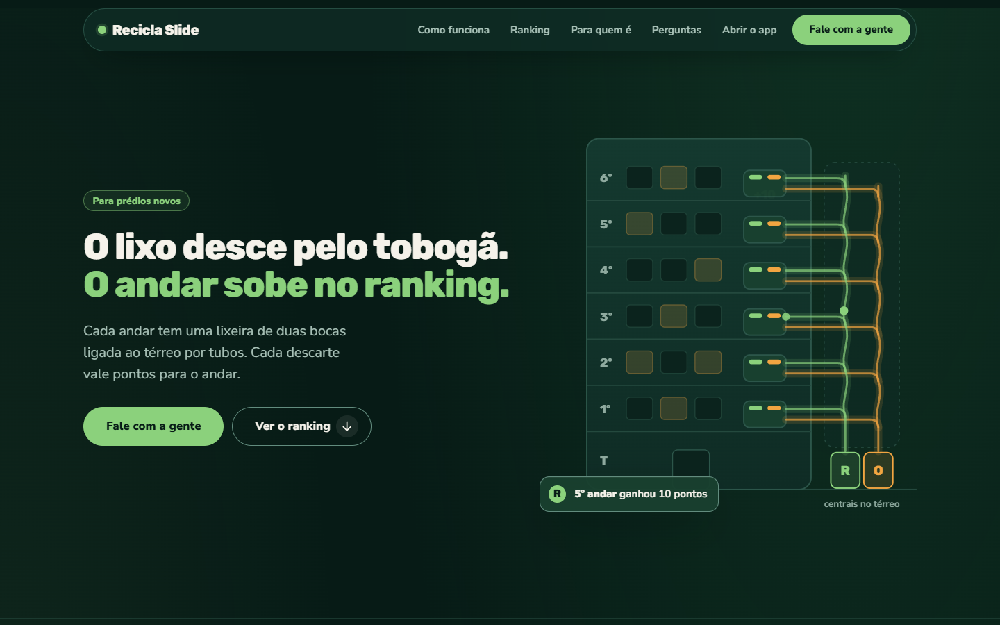 | 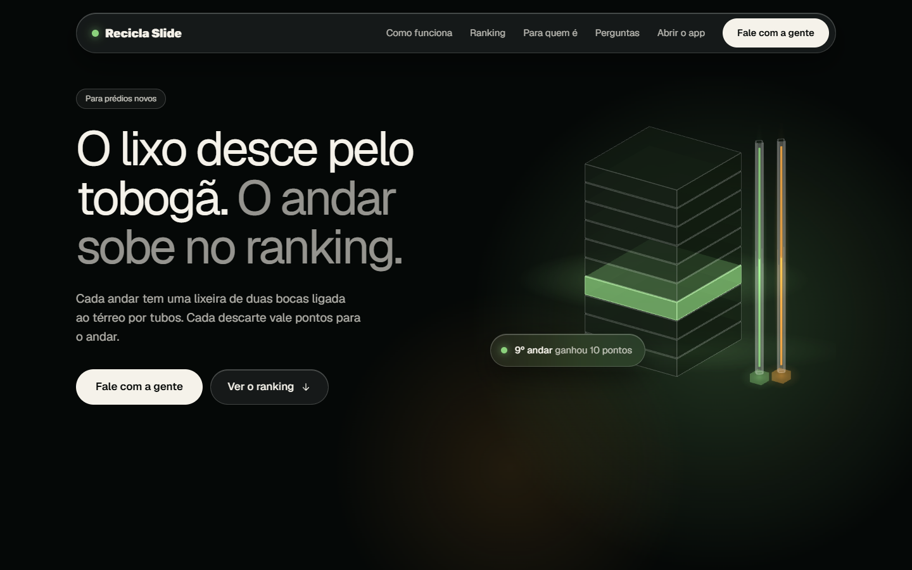 | 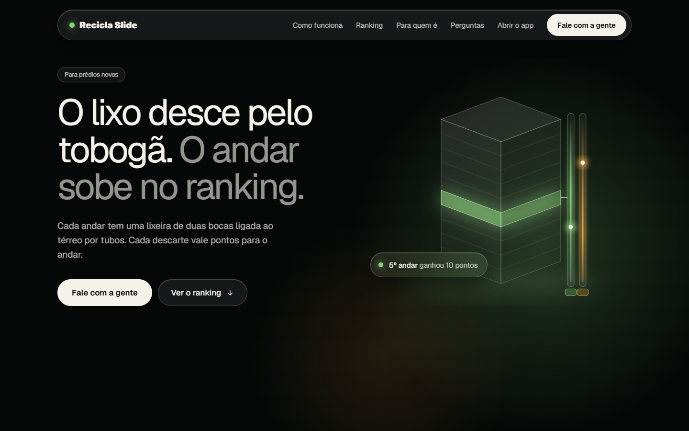 |
| App, Início (390 px) | 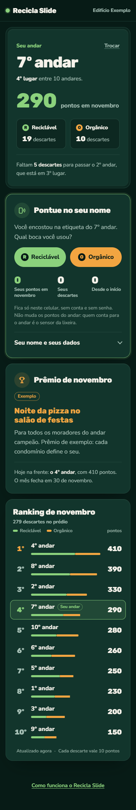 | 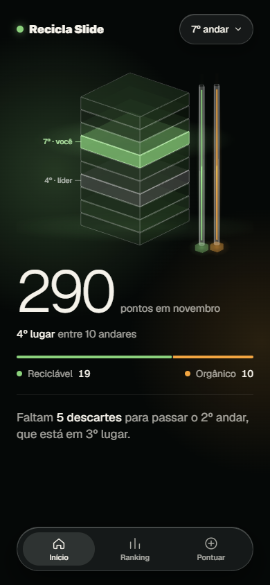 | 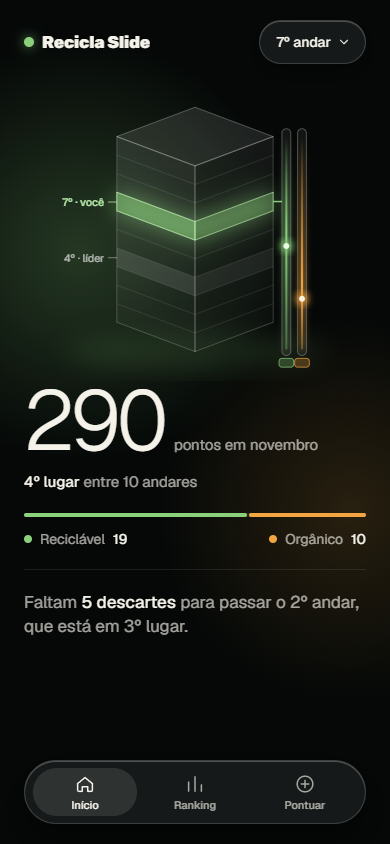 |
| App, Ranking | | 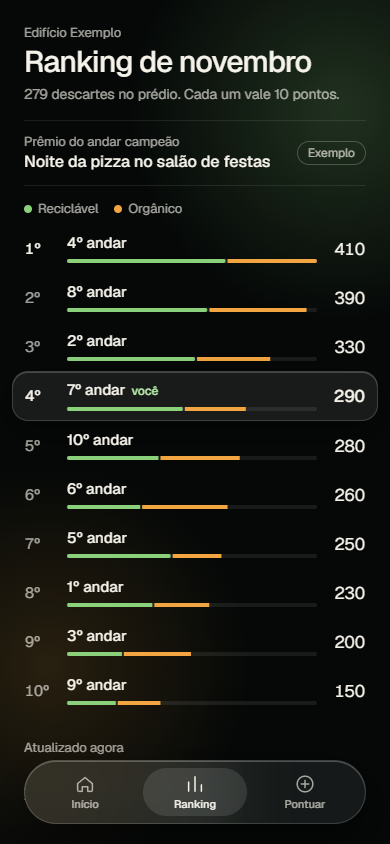 | 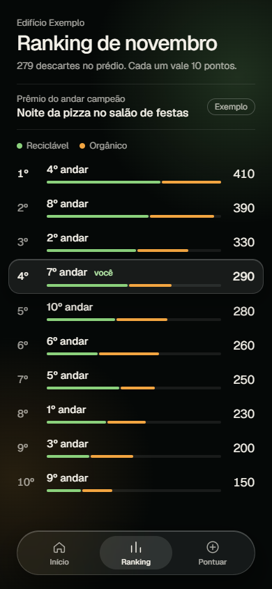 |
| App, folha Pontuar | | 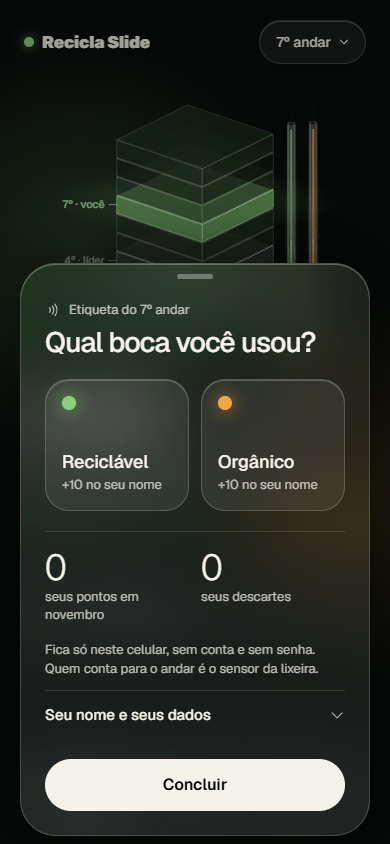 | 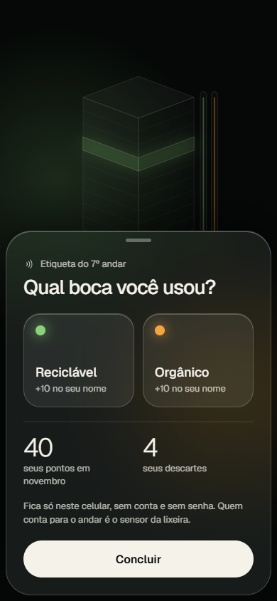 |
| Telão (1920 px) | 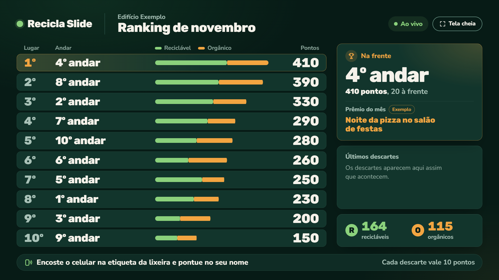 | 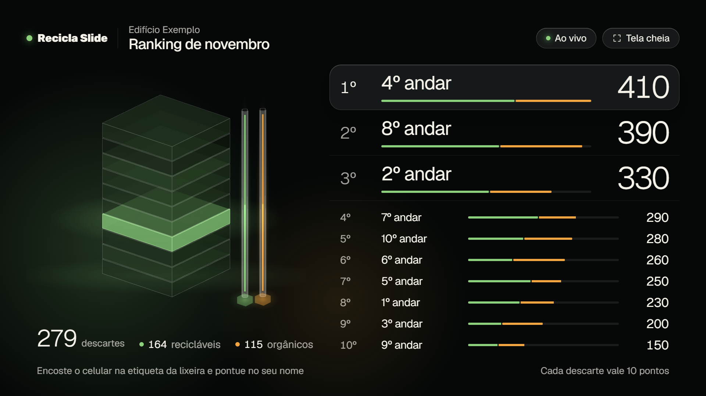 | 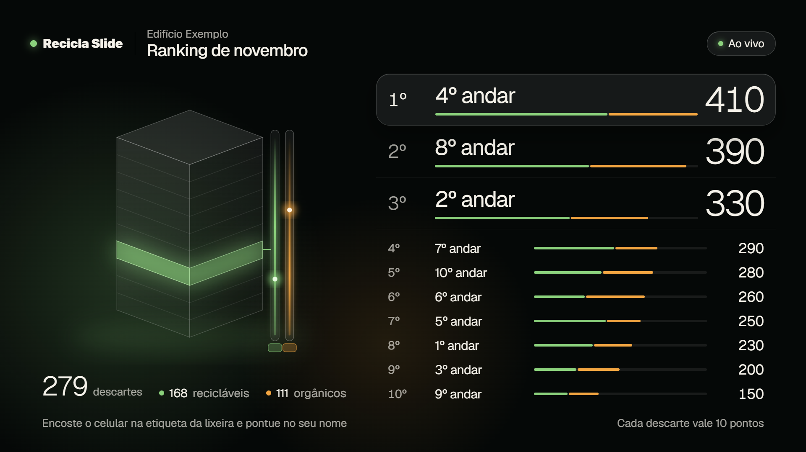 |
| Telão com o prédio em 3D | | 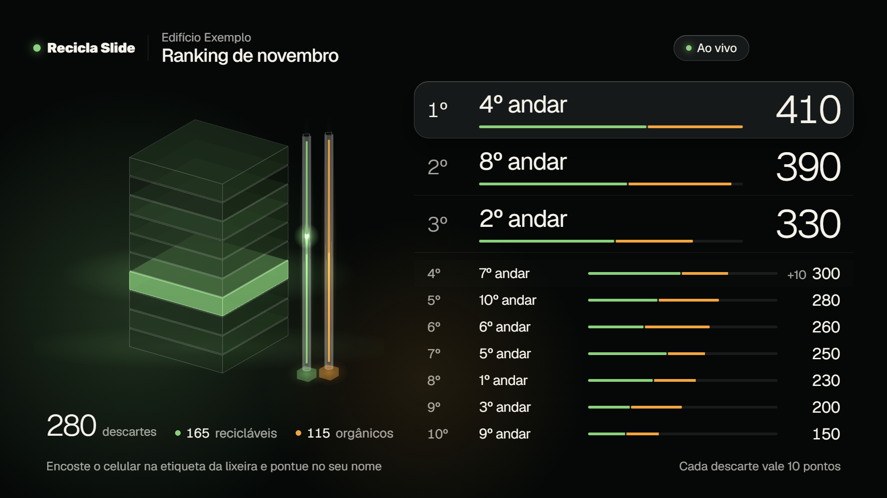 | |
| Painel | 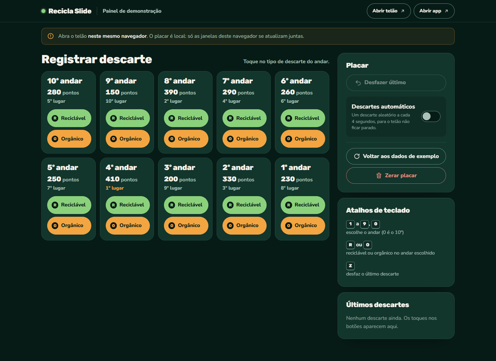 | 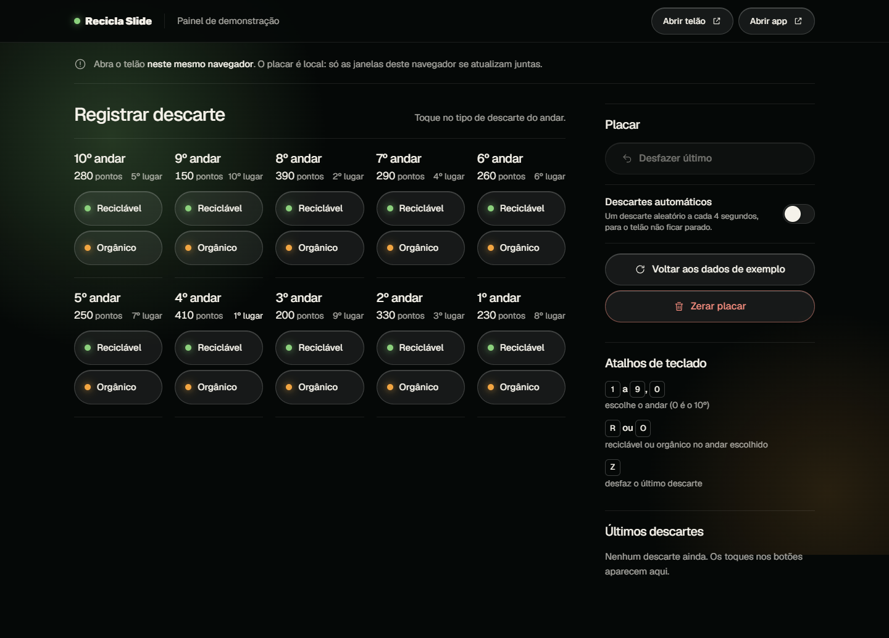 | |

## O que mudou

**Base**
- `DESIGN.md` reescrito. `css/base.css` tem as variáveis novas: fundo `#050807`, texto `#F5F2EA`, linhas e vidro em branco translúcido. Verde e laranja só como sinal.
- Geist variável salva em `fonts/`. O Rubik ficou só no logo, e a Nunito Sans saiu do projeto.
- Componentes novos:
  - vidro e botão principal claro;
  - botões "Reciclável" e "Orgânico" de vidro, com um ponto colorido no lugar das antigas fichas R e O;
  - barra de proporção;
  - linha fina;
  - chip "Exemplo" neutro;
  - aviso em cápsula de vidro, que fica por cima das folhas;
  - diálogo de vidro.
- Luz ambiente atrás de todas as telas: duas manchas, uma verde e uma laranja. No site e no app ela deriva devagar; no telão fica parada.

**O prédio**
- `js/predio.js` gera o SVG das referências para qualquer número de andares. Ele mostra o andar aceso, o realce do líder e os rótulos "você" e "líder", e solta um ponto de luz que desce pelo tubo certo a cada descarte.
- `js/predio3d.js` faz o mesmo desenho em 3D, com Three.js 0.180 salvo no projeto:
  - câmera isométrica e andares translúcidos;
  - tubos de vidro com um filete de luz dentro;
  - balanço lento, e no app e no site dá para arrastar e girar;
  - o 3D só entra com WebGL, sem "reduzir movimento", fora do modo estável e acima de 30 quadros por segundo; senão, volta ao SVG.

**Telas**
- **App:** a página longa virou duas abas, Início (`#inicio`) e Ranking (`#ranking`), mais a folha Pontuar (`#pontuar`), com uma barra de navegação de vidro.
  - Com `?andar=7`, a folha abria sozinha depois de 600 ms. Na Etapa 0 do `prompt-app.md` isso virou um aviso "Pontuar agora" no topo do Início (veja `ETAPAS.md`).
  - A folha prende o foco e fecha com Esc, com toque no fundo, com "Concluir" ou com o botão voltar do navegador.
  - Trocar de andar virou uma folha também.
- **Telão:**
  - à esquerda, o prédio com o líder aceso e os totais;
  - os três primeiros em linhas grandes (o líder em vidro) e os demais em linhas finas;
  - novo líder: o ranking escurece, entra uma folha de vidro com um feixe de luz e some depois de 4 s;
  - modo estável `?estavel=1`, para TV que pisca;
  - modo TV em pé;
  - sensor dentro da coluna esquerda.
- **Site:**
  - abertura igual à referência, com o laço de demonstração do prédio;
  - passos em lista numerada com linhas finas;
  - demonstração do ranking numa superfície de vidro;
  - "Para quem é" em duas colunas, perguntas em sanfona, contato e rodapé.
- **Painel:** mesmo layout e mesmas funções. Os blocos são separados por linha fina, os botões são de vidro com ponto colorido e a chave nova fica verde quando ligada.
- **404:** o prédio com todos os andares apagados e "Esse andar não existe.".

**Movimento**
- Uma curva só para quase tudo e mais nada que pule.
- O número conta, a linha brilha de leve e aparece um "+10" pequeno.
- As linhas deslizam para a nova posição.
- Com "reduzir movimento", tudo fica parado, inclusive o prédio.

**PWA e qualidade**
- Manifest em `#050807`, com ícones e imagem de compartilhamento refeitos no visual novo.
- Service worker v4 com a lista nova de arquivos, inclusive o 3D. Funciona sem internet.
- 33 testes passando, com 6 novos:
  - abas pelo endereço;
  - folha Pontuar abrindo e fechando;
  - folha abrindo sozinha com `?andar=7`;
  - SVG quando não há WebGL;
  - 3D quando há WebGL;
  - telão estável sem desfoque, sem canvas e sem animação.
- A auditoria (`tools/auditoria.mjs`) não aponta nada: contraste AA, foco visível, nomes acessíveis, títulos e alvos de toque de 44 px.
- 9 ciclos de polimento; os três últimos não acharam nada relevante. Os achados mais importantes:
  - o aviso ficava escondido atrás da folha;
  - aparecia uma linha dupla no celular;
  - o painel tinha vidros demais;
  - o SVG continuava aparecendo por baixo do 3D.

**Refração do vidro (bônus): testada e desligada.** No Chrome, ela anulava o desfoque e o texto de trás aparecia nítido pela folha. A captura está em `docs/redesign/refracao-testada.png`.

## Publicação

Publicado em **https://tafnerdev.github.io/recicla-app/** (repositório https://github.com/tafnerdev/recicla-app). Antes do envio, a branch `redesign` foi juntada na `main`. O PWA foi conferido no endereço publicado: instala, guarda 34 arquivos e abre sem internet.

O que ainda depende de vocês está no [PENDENCIAS.md](PENDENCIAS.md): textos novos que a estrutura pediu, contato e prêmio de exemplo, logo definitivo e a gravação das etiquetas NFC com o endereço publicado.

## Como conferir cada tela em 2 minutos

Na pasta do projeto, rode `npm run servir` e abra `http://localhost:8080/` no Chrome.

**Site (`/`)**
1. Compare a primeira dobra com `docs/redesign/referencia-site-abertura.png`.
2. Espere alguns segundos: um ponto de luz desce pelo tubo e o chip mostra qual andar ganhou 10 pontos.
3. Arraste o prédio para girar e solte: ele volta sozinho.
4. Role até "Escolha um andar e faça um descarte". Com o 7º andar escolhido, toque 5 vezes em "Reciclável": a linha sobe para o 3º lugar.

**App (`/app/?andar=7`)**
1. Toque no aviso "Você está no 7º andar. Pontuar agora" para abrir "Qual lixeira você usou?". Toque em "Reciclável": os números contam e aparece o aviso no topo.
2. Toque em "Concluir". Na aba Início, compare com `referencia-app-inicio.png`: prédio com o 7º aceso, 290 pontos e "Faltam 5 descartes".
3. Toque em "Ranking" na barra e compare com `referencia-app-ranking.png`. Use o voltar do navegador para retornar à aba Início.
4. Toque no chip "7º andar" no topo para trocar de andar.

**Telão (`/telao/`) com o painel (`/demo/`) no mesmo navegador**
1. Compare o telão com `referencia-telao.png`.
2. No painel, toque 5 vezes em "Reciclável" no 7º andar. No telão, o ponto de luz desce, o número conta e a linha desliza para o 3º lugar com a seta para cima.
3. Toque 3 vezes em "Orgânico" no 8º andar: entra a folha "Novo líder" por 4 s.
4. Abra `/telao/?estavel=1`: nada desfoca, o prédio fica em SVG e a linha que pontua só fica mais clara por 2 s.
5. Termine com "Voltar aos dados de exemplo" no painel.

**Painel (`/demo/`)**
1. Teste as teclas `7` e depois `R`. Depois `Z` para desfazer.
2. Ligue "Descartes automáticos": a chave fica verde. Desligue.
3. Toque em "Zerar placar" e em "Cancelar" no diálogo de vidro.

**Testes e auditoria:** `npm test` (33 testes, cerca de 16 s) e `node tools/auditoria.mjs` (deve terminar com "Nenhum apontamento.").
